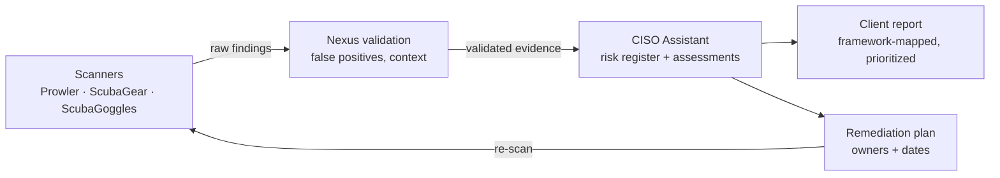

# Framework Selection and Evidence Mapping

Which CISO Assistant library frameworks to load for each Nexus client type, and how scanner evidence feeds into them. Library contents change over time, so confirm the current framework list in your deployed version.

## Frameworks by client type

| Client type | Load first | Add as needed |
|---|---|---|
| **Any SMB (default)** | NIST CSF 2.0 | CIS Controls v8 (if available) for prioritized safeguards |
| **Defense supplier / DIB** | NIST SP 800-171 Rev 2 (current CMMC L2 basis), CMMC 2.0 | NIST SP 800-171 Rev 3 to plan ahead |
| **Healthcare / HIPAA covered entity or BA** | HIPAA Security Rule (if available in library), NIST CSF 2.0 | HHS 405(d) HICP practices as a guide |
| **SaaS / tech vendor** | SOC 2 (TSC 2017), NIST CSF 2.0 | ISO/IEC 27001:2022 |
| **Financial services** | NIST CSF 2.0 | FFIEC / state requirements (e.g., NYDFS Part 500) where applicable |
| **AI-heavy organization** | NIST AI RMF, ISO/IEC 42001 (if available) | EU AI Act for EU exposure |

Use CISO Assistant's **mapping** features to reuse evidence across frameworks instead of assessing the same control twice.

## Where scanner evidence goes

| Evidence source | NIST CSF 2.0 categories it supports |
|---|---|
| Prowler (cloud) | ID.AM, ID.RA, PR.AA, PR.DS, PR.PS, PR.IR, DE.CM |
| ScubaGear (M365) | PR.AA, PR.DS, PR.PS, DE.CM, DE.AE |
| ScubaGoggles (Google Workspace) | PR.AA, PR.DS, PR.PS, DE.CM, DE.AE |
| Policy and interview evidence (Nexus posture review) | GV (all), ID.IM, PR.AT, RS, RC |

Automated scanners cover technical controls well and governance controls poorly. **GV, RS, and RC** always need interviews, documents, and tabletop evidence.

## Framework versions and status (verified 2026-10-31)

Check these before every engagement; regulatory timelines move.

| Framework | Version to assess against | Status that matters for clients |
|---|---|---|
| NIST CSF | **2.0** (Feb 2024) | Adds the *Govern* function; CSF 1.1 category IDs no longer apply. |
| NIST SP 800-171 | **Rev 2** for CMMC; Rev 3 (May 2024) for awareness | CMMC Level 2 practices are defined by **Rev 2**. Use Rev 2 requirement numbers in CMMC reports even though Rev 3 is current. |
| CMMC | **2.0** (32 CFR 170; 48 CFR DFARS rule effective **Nov 10, 2025**) | **Phase 2 starts Nov 10, 2026**: Level 2 third-party (C3PAO) certification becomes a condition of award where required. Phase 3 (Nov 10, 2027) extends it to option periods. |
| HIPAA Security Rule | 45 CFR 164 Subpart C (current rule) | The Jan 2025 proposed overhaul (mandatory MFA, encryption, asset inventory) is **not final**; HHS moved its target to **July 2027**. Recommend the proposed controls as best practice, but assess against the current rule. |
| SOC 2 | AICPA Trust Services Criteria (2017) with **revised points of focus (2022)** | Readiness only; the client's auditor decides. |

## References

Sources are kept to roughly the last four years; re-verify the status column above at each engagement.

- **CISO Assistant** framework library (check that the library version matches the framework revision you assess against): <https://github.com/intuitem/ciso-assistant-community> (evergreen).
- NIST (2024). *The NIST Cybersecurity Framework (CSF) 2.0* (CSWP 29). <https://csrc.nist.gov/pubs/cswp/29/the-nist-cybersecurity-framework-csf-20/final>
- Ross, R., & Pillitteri, V. (2024). *Protecting controlled unclassified information in nonfederal systems and organizations* (NIST SP 800-171 Rev. 3). <https://csrc.nist.gov/pubs/sp/800/171/r3/final>
- Department of Defense (2025). *DFARS: Assessing contractor implementation of cybersecurity requirements* (CMMC 48 CFR final rule, effective Nov 10, 2025). Summary and phase dates: <https://www.cooley.com/news/insight/2025/2025-09-25-dod-releases-long-awaited-final-rule-implementing-cybersecurity-maturity-model-certification-contract-clause>
- Fierce Healthcare (2026). *Feds push back HIPAA security rule overhaul to July 2027*. <https://www.fiercehealthcare.com/health-tech/feds-push-back-hipaa-security-rule-overhaul-july-2027>
- AICPA (2022). *2017 Trust Services Criteria (with revised points of focus, 2022)*. Overview: <https://www.barradvisory.com/resource/whats-new-with-soc-2/>
- Nelson, A., Rekhi, S., Souppaya, M., & Scarfone, K. (2025). *Incident response recommendations and considerations for cybersecurity risk management* (NIST SP 800-61r3). <https://csrc.nist.gov/pubs/sp/800/61/r3/final>
